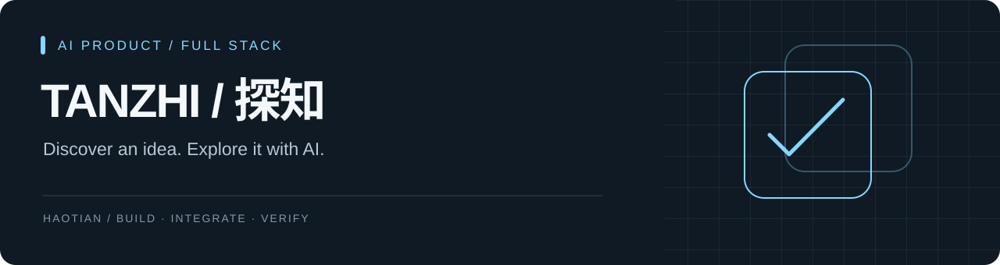

# 探知 · Tanzhi AI

面向产品经理和程序员的 AI 认知探索平台：从一张知识卡片发现问题，再通过 AI 对话深入理解。

**React 19 · Vite · Node.js / Express · MySQL · 豆包 API**

## 产品路径

选择角色与兴趣 → 浏览知识卡片 → 围绕卡片展开讨论

- 用户端：兴趣引导、卡片流、AI 讨论和个人页。
- 管理端：卡片、用户、标签、生成日志与检索调试。
- 服务端：身份认证、内容推荐、模型接口与向量去重。

## 架构

```text
React 用户端 ─┐
             ├─ Express API ─ MySQL
React 管理端 ─┘       └────── 豆包对话 / Embedding
```

## 本地运行

需要 Node.js、MySQL 和自己的模型服务配置。分别在 `client`、`admin`、`server` 运行 `npm ci`，按 [安装说明](docs/SETUP.md) 准备隔离数据库与环境变量，再启动三个服务。

数据库初始化脚本会写入所连接的数据库；请仅使用自己的本地测试库。示例配置不是可用账号或密钥。

## 版本边界

本仓库展示已公开的基础版本。本地仍在迭代的手记、版本冲突、内容发布审核等能力尚未合并到这个公开版本；README 不将这些能力视为已经交付。

本次 GitHub 整理保留已有应用代码与提交历史，更新项目介绍、展示资源和复现说明，不进行线上部署。模型质量、真实账号流程与数据库联调需要单独验收。

→ [系统地图](SYSTEM-MAP.md) · [发布检查](docs/PUBLISH-CHECKS.md)

## License

[MIT](LICENSE)
